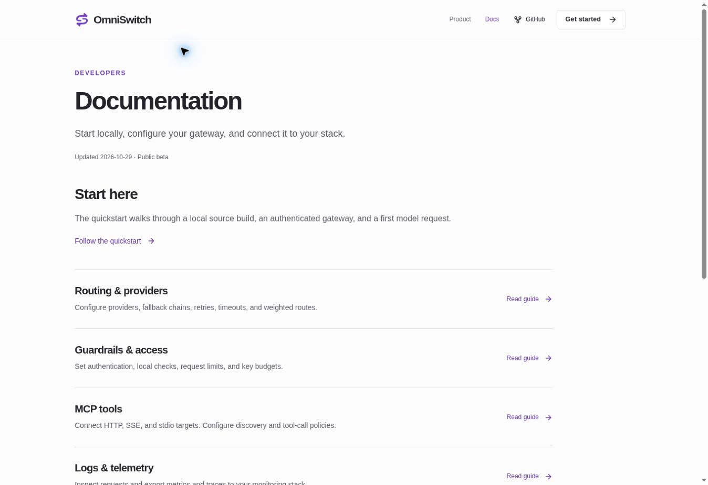
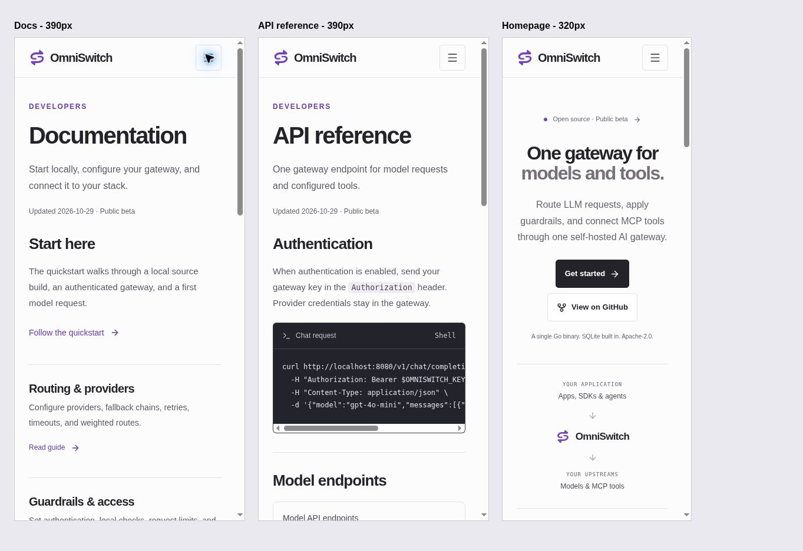

# Focused pages and minimal identity

Reviewed 2026-10-29.

The public site has five pages: Home, Quickstart, Documentation, API reference, and Security. Thirteen previous pages plus the old `/comparison` alias redirect to useful current content. The sitemap includes only the current pages. Long comparison matrices, speculative release copy, duplicate install instructions, and marketing-only pages are removed.

The homepage layout stays close to the approved first pass. Supporting pages now use short technical summaries, one focused quickstart, and direct links to first-party documentation. The source build uses the official product repository at commit `5df77bbb1852ac02faa92ce8fcfffca2bcabe6dc`, with its Go 1.26 requirement. The v0.2.0 release is still marked unpublished.

## Logo assets

The new identity uses two opposing routes to suggest switching and an S. ImageGen supplied the initial visual direction; the final mark is implemented as clean, flat SVG geometry for small sizes. The header, footer, favicon, and social cards share the same mark.

- `public/brand/omniswitch-mark.svg`: scalable transparent mark.
- `public/brand/omniswitch-wordmark.svg`: mark and wordmark.
- Matching transparent PNGs are provided in the same directory.
- `public/favicon.svg` uses the same geometry.

Built-in ImageGen concept prompt:

> Create a finished minimalist logo symbol for OmniSwitch, an open-source AI gateway. Symbol only, no wordmark, no letters, no text. Design a compact abstract switching/routing mark from two opposing rounded paths that together suggest a subtle S and continuous connection. Extremely simple geometry, balanced negative space, confident mature developer-infrastructure identity. Flat single-color deep violet #7542BF. Center the mark with modest padding, occupying roughly 75% of a square canvas. Truly transparent background. Crisp vector-like contours, uniform visual weight, legible at favicon scale. No gradients, shadows, glow, outlines around a tile, containers, 3D, texture, dots, mockups, or decorative elements. Original identity with the restraint of established open-source infrastructure brands.

## Verification

- Formatting, whitespace checks, and all 17 tests pass.
- Production/static checks pass for five public pages and 404, including internal links, metadata, social cards, sitemap, and all 14 redirects.
- The existing 429-row historical claims register still passes its integrity check; it is no longer included in the public client bundle.
- JavaScript download: 70.76 KB gzip, down from 105.48 KB in the previous pass.
- Desktop browser review covers Docs, navigation, and a retired comparison URL redirecting to Docs.
- Fixed-width browser frames verify Docs and API at 390 px, Home at 320 px, native mobile navigation, and horizontally scrollable API endpoints. Physical-device testing was not performed.
- First-party configuration, deployment, API, observability, and limitations guide files were verified at the pinned product commit.
- Gateway runtime tests and production deployment are outside this website verification.

