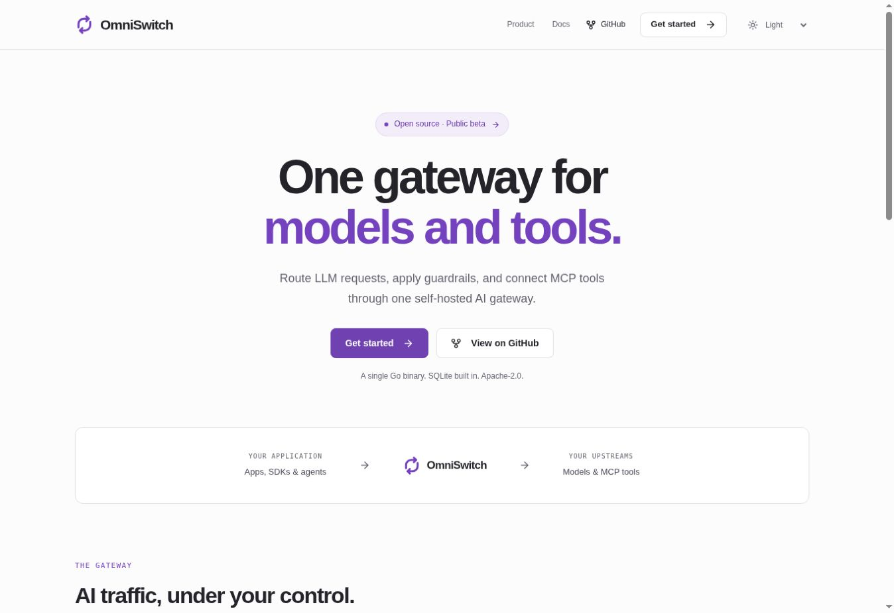

# Minimal identity and themes

Updated 2026-11-09.

Keep the product site quiet: whitespace, short copy, clear typography, thin borders, and one violet accent. Avoid decorative animation and heavy gradients. Preserve the five-page navigation and source-backed product descriptions.

## Mark

The two opposing paths form an open routing loop. Its rounded, uniform strokes stay readable at navigation and favicon sizes. The geometry lives in `src/data/brand.js`; `BrandMark` uses the active theme's accent color.

`npm run brand` generates the transparent marks and wordmarks, adaptive favicon, and 180/192/512 px home-screen icons. Use the `-light` asset variants on dark backgrounds. Keep the mark square and leave clear space around it. `npm run og` regenerates all six social previews from the same identity.

## Theme behavior

- Light is the default for a first visit, including on a dark-system device.
- Light, Dark, and System are explicit choices in a native, keyboard-accessible select.
- The saved choice applies before content paints, persists across routes and reloads, and syncs between tabs. System follows operating-system changes.
- If storage is unavailable, switching still works for the current page session.
- Without JavaScript, prerendered content and the native mobile menu remain usable in light mode; the inactive theme control stays hidden.
- Browser chrome colors follow the selected theme after route metadata changes.

## Palette

| Role    | Light     | Dark      |
| ------- | --------- | --------- |
| Page    | `#fcfcfd` | `#131217` |
| Surface | `#ffffff` | `#1a1820` |
| Text    | `#242329` | `#f3eff9` |
| Accent  | `#7542bf` | `#bd9aef` |
| Border  | `#e3e2e8` | `#35313f` |

Tokens are in `src/styles/tokens.css`. Code examples keep their own dark palette in both themes. Reduced-motion preferences disable transitions.

## Verification

- All 20 tests pass, including before-paint preferences, blocked storage, and browser theme colors.
- Formatting, claims, and production checks pass for the five pages and 404; client JavaScript remains below the 150 KB gzip budget.
- Browser review covers light/dark themes, persistence on reload, cross-tab theme synchronization, Docs navigation, and mobile menu navigation.
- Fixed-width frames cover the homepage at 320 px and API reference at 390 px (305/375 px content areas after scrollbars), with no page overflow. This is browser layout QA, not physical-device testing.

