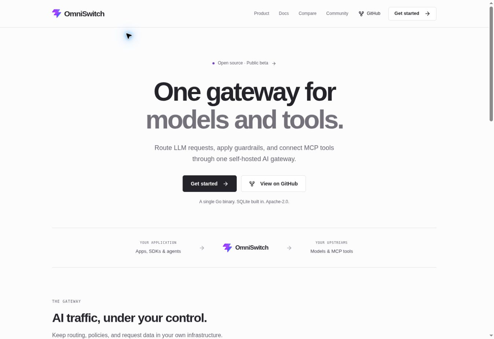
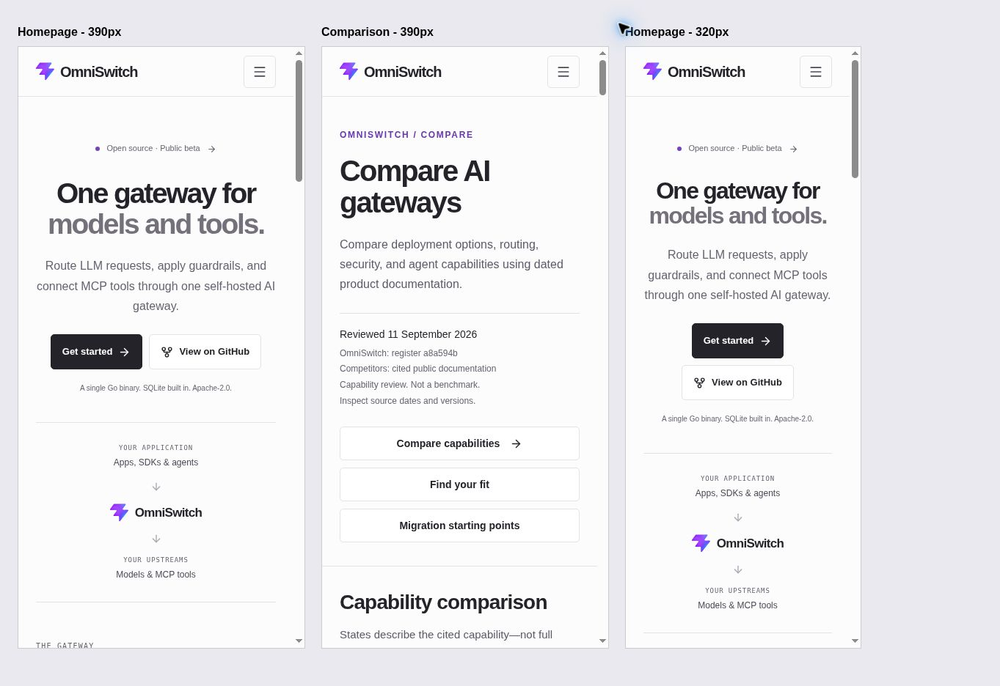

# Minimal product website

Design review: 2026-10-29.

The homepage now explains the self-hosted gateway in four sections: an introduction and request path, four capabilities, an OpenAI client example, and a quickstart. The light neutral theme uses charcoal type and restrained violet accents. Shared navigation, documentation, comparisons, browser theme colors, and social cards use the same direction.

Product copy uses existing sourced capabilities. The comparison register and release publication state are preserved. Supporting page titles use direct names such as Documentation, Quickstart, Security, and API reference.

## Verification

- Formatting and whitespace checks pass.
- All 16 existing unit tests pass, with zero lint warnings or errors.
- Production build and static checks pass for 18 routes and the 404 page, including metadata, JSON-LD, social images, internal links, anchors, and marketing language.
- All 429 comparison claims match their pinned source.
- JavaScript: 105.48 KB gzip, below the 150 KB budget.
- Browser review: desktop homepage and comparison, quickstart navigation, code-copy fallback, and prerendered mobile layouts at 390 and 320 CSS pixels. The native mobile menu opens correctly without JavaScript. Mobile review uses the built HTML and CSS in fixed-width frames, rather than a physical device.
- Clipboard access is unavailable on the HTTP development origin; the existing selectable-code fallback was verified.
- This review does not rerun gateway benchmarks, release artifact checks, Lighthouse, or an external link audit.

## Screenshots

