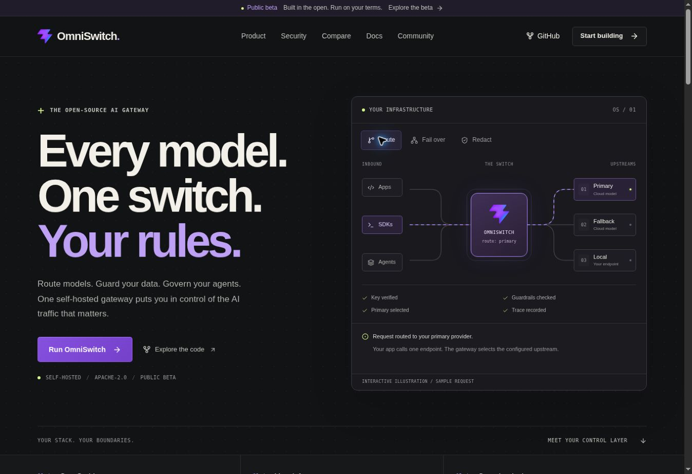

# OmniSwitch switchboard design

Reviewed 2026-10-29. The visual direction centers on a switchboard: explicit request paths, local controls, and ownership of the infrastructure. It retains the existing lightning mark and violet identity, adds lime status accents and a pale developer section, and uses system fonts without new dependencies.

The hero explores routing, configured failover, and PII redaction using local sample states. The control panels are illustrations, not console screenshots or performance measurements. Their capabilities restate the sources in `CLAIMS.md`. The immutable comparison register and release publication state are preserved.

## Verification for this change

- `npm run format:check`, `npm test` (16 tests), and `npm run build` pass. The build checks all 19 generated pages, metadata, internal links and anchors, social cards, claims, and marketing-language constraints.
- Client JavaScript is 109.75 KB gzip, below the existing 150 KB budget. No runtime dependency was added.
- Browser review covers the desktop homepage, developer section, and comparison hub. Home fits 320, 390, and 768 px preview frames without horizontal overflow. Documentation and comparison navigation fit the 390 px frame.
- All three sample request scenarios update the selected state and live explanation. Keyboard navigation shows a visible focus outline. Mobile navigation opens, follows links, and closes after navigation.
- The default illustration and page content are prerendered. The existing global reduced-motion rule disables the finite wire animation. A new Lighthouse, axe, or assistive-technology session was not run; older scores in `docs/WEBSITE_VERIFICATION.md` do not describe this redesign.
- Browser logs after reload contain no application errors; browser-extension metadata errors are unrelated to the site.

The existing Vercel deployment configuration and routes are retained. Production publication follows the repository's normal merge/deployment process.
